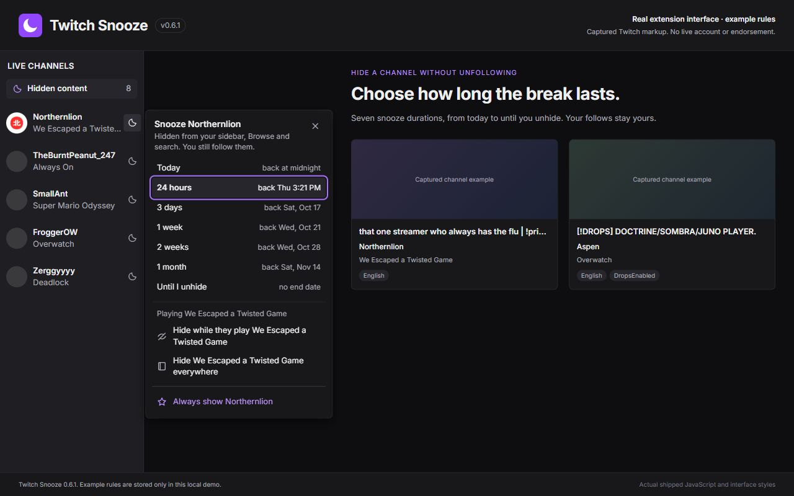
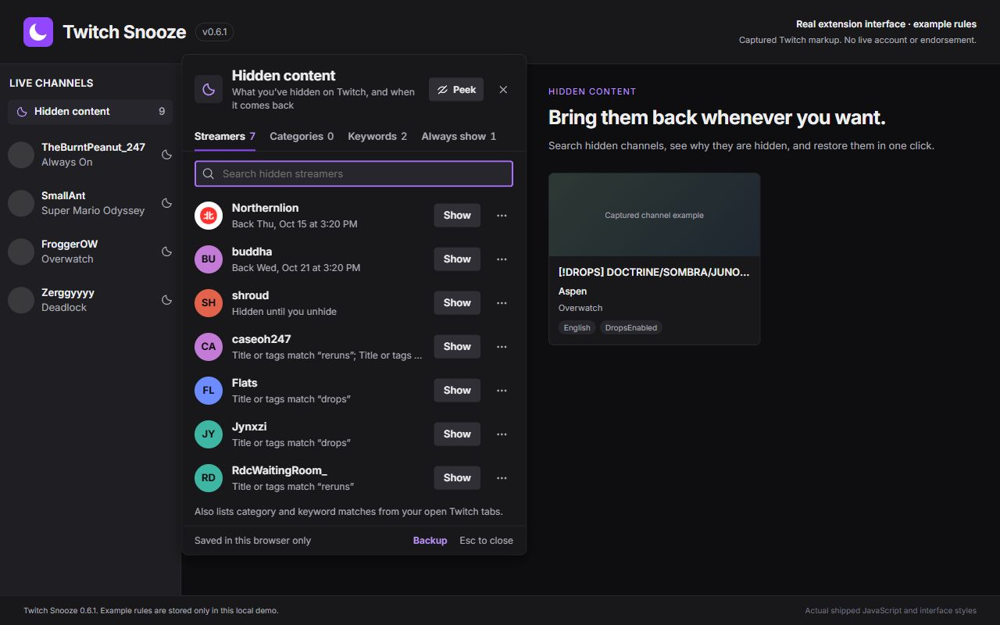
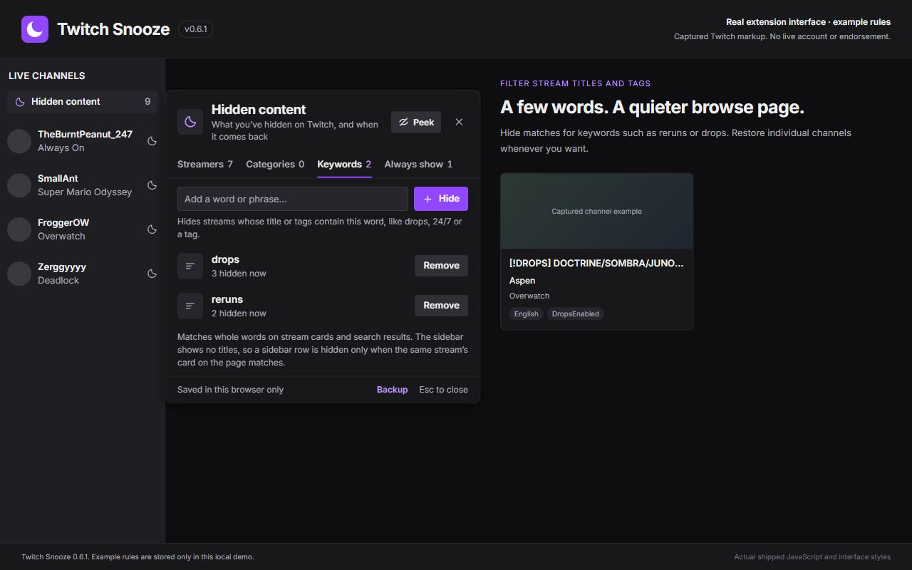
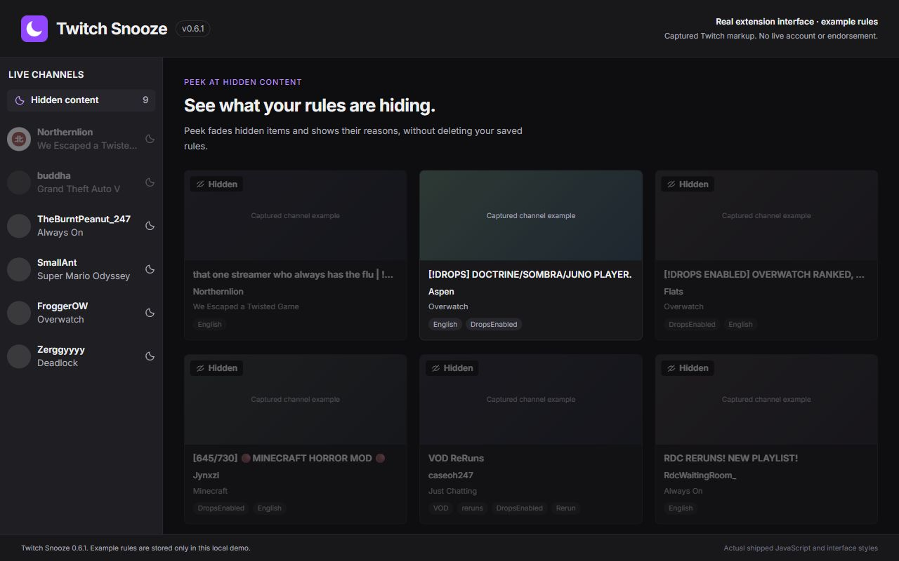
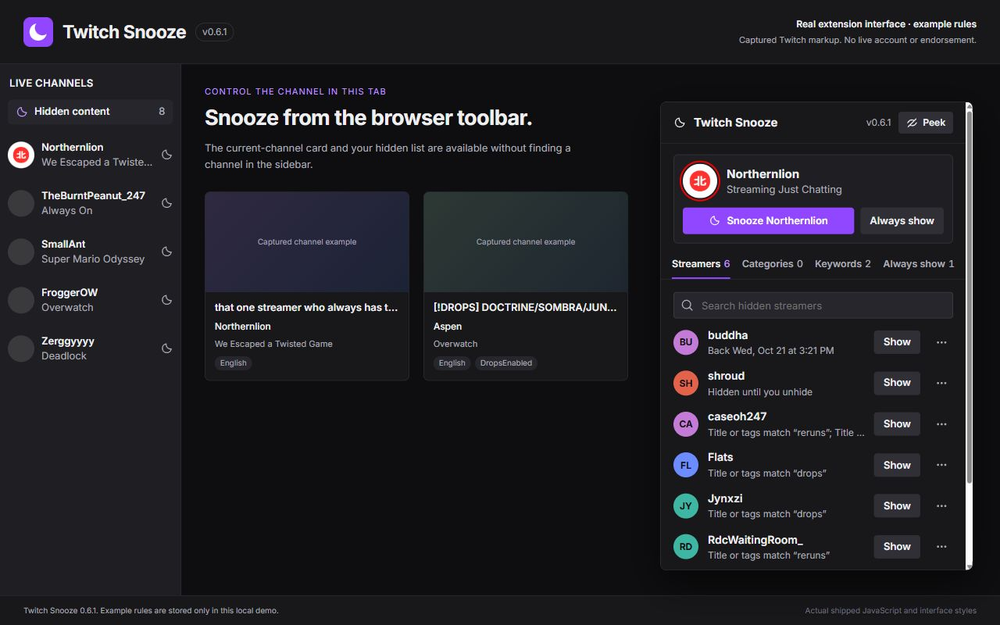

# Twitch Snooze: Hide Channels & Categories

Clean up Twitch by hiding streamers and categories without unfollowing anyone. Twitch Snooze is a browser extension for desktop Chrome and Microsoft Edge.

**Source version 0.6.1 · Manifest V3 · MIT licensed · No runtime dependencies**

## Install from a browser store

Use the official store version for automatic updates:

- [Install Twitch Snooze for Chrome](https://chromewebstore.google.com/detail/fhdnokolfhacaokdidacdcabpimhgdkm)
- [Install Twitch Snooze for Microsoft Edge](https://microsoftedge.microsoft.com/addons/detail/glcfgomfljbmcgomligjegknmhpebohm)

Version 0.6.1 is available in the [GitHub release](https://github.com/raccooovl/twitch-snooze/releases/tag/v0.6.1). Browser-store updates become available after each store approves the submission; check its listing for the version currently offered.

## Get started

[Hide Twitch channels without unfollowing](https://perfsn-extensions.basstank2004.chatgpt.site/twitch-snooze/hide-channels/?utm_source=github&utm_medium=referral&utm_campaign=discovery_2026_10&utm_content=twitch_readme_guide)

[Product page](https://perfsn-extensions.basstank2004.chatgpt.site/twitch-snooze/) · [Setup and troubleshooting guide](https://perfsn-extensions.basstank2004.chatgpt.site/twitch-snooze/guide/)

1. Install Twitch Snooze from the store for your browser.
2. Open or refresh Twitch on desktop.
3. Click the moon beside a channel to snooze it, or open **Hidden content** to manage streamers, categories, keywords and **Always show** exceptions.

## Features

- Snooze for Today, 24 hours, 3 days, 1 week, 2 weeks, 1 month, or until you unhide them.
- Hide a category, or hide one streamer only while they play it. Category rules keep working if you change Twitch's language.
- Hide streams by keywords or tags in their titles, such as `drops`, `reruns` or `24/7`.
- Hide or restore the channel you're watching from the toolbar popup.
- Works in the sidebar, Browse, video and clip lists, search results and the homepage carousel.
- Peek mode shows hidden items faded, to check what your rules catch.
- Undo any change, and back up or restore your rules with a file.
- Looks like part of Twitch, in light and dark themes, in English, Dutch, German, Spanish and Brazilian Portuguese.
- Keep favourite streamers visible using **Always show** or category exceptions.
- Manage rules in the **Hidden content** panel or the extension toolbar popup, with streamers' Twitch profile pictures and initials when no image is available.
- Store rules locally without analytics or external API calls. Profile pictures load from Twitch's image server; see [Privacy](PRIVACY.md) for request details.

## Install from source for development

1. Clone or download this repository.
2. Open `edge://extensions` and enable **Developer mode**.
3. Choose **Load unpacked** and select the `extension` folder containing `manifest.json`.
4. Refresh Twitch, then click the moon beside a channel or **Hidden content** near the sidebar header.

To apply source updates, reload the extension at `edge://extensions` and refresh Twitch. The extension also supports Chromium browsers that implement Manifest V3.

For Chrome, use `chrome://extensions` with the same **Developer mode** and **Load unpacked** steps. Store installation above is recommended for everyday use.

## Development

All runtime source is in `extension/`:

- `core.js`: rule normalization, duration handling, matching and whitelist precedence.
- `background.js`: local state, serialized changes, expiry alarms and tab observations.
- `content.js` / `content.css`: Twitch integration and hiding supported cards.
- `ui.js` / `ui.css`: shared controls, menus and Hidden Content manager.
- `ui-css.js`: generated copy of `ui.css` used on Twitch pages. After editing `ui.css`, run `node tools/build-ui-css.cjs`.
- `i18n.js` and `_locales/`: translations. Edit `tools/messages.cjs` (every language side by side), then run `node tools/build-locales.cjs`.
- `fonts.css` and `fonts/`: the Inter typeface for the popup and Backup page (SIL Open Font License).
- `popup.html` / `popup.js`: toolbar management interface.
- `options.html` / `options.js`: Backup page (export and import).

Run the dependency-free logic/background regression suite with Node.js 20 or newer:

```sh
node --test tests/core.test.cjs
node tools/build-ui-css.cjs --check
node tools/build-locales.cjs --check
```

Browser checks with Playwright (captured Twitch markup, then live public pages) are in `tests/browser/`; see its README.

For a store package, ZIP the **contents** of `extension/` so that `manifest.json` is at the archive root, leaving out `VERIFICATION.md`. Store descriptions in every language are in `STORE-LISTING.md`. Development tests, tools and repository metadata are not needed in the package.

See [usage instructions](extension/README.md), [changelog](extension/CHANGELOG.md), and [verification scope](extension/VERIFICATION.md).

## Screenshots

These screenshots render the shipped 0.6.1 interface with example rules and captured Twitch page markup. They show a local demonstration rather than a live account. Twitch Snooze is independent of Twitch and the channels shown.

### Choose when a channel returns



### Manage hidden streamers



### Filter titles and tags



### Check what your rules hide



### Manage the current channel from the toolbar



## Privacy and limitations

Read [the privacy policy](PRIVACY.md) for the local data stored and Twitch page content accessed. Permissions are limited to `storage`, `alarms`, and content-script access to `https://www.twitch.tv/*`.

Category matching depends on category text and links currently exposed by Twitch. Unknown categories remain visible. Keywords apply to stream cards; Twitch's sidebar has no titles. The extension changes supported cards, not direct channel access, playback, follows, subscriptions, or chat. Rules are saved per browser profile and do not sync across devices.

## Support and contributions

Read the [support guide](SUPPORT.md) for setup help and useful bug-report details.

Please [open an issue](https://github.com/raccooovl/twitch-snooze/issues) or email [support@perfsn.xyz](mailto:support@perfsn.xyz) with the extension version, browser version, what happened, and the relevant Twitch page type. Avoid posting passwords, cookies, private messages, or other sensitive information. Issues are public and processed by GitHub under its own privacy policy.

Bug fixes and focused improvements are welcome. Preserve normal channel-link behaviour, the snooze choices, local-only data handling and minimal permissions. Include relevant regression checks with behaviour changes.

## License

[MIT](LICENSE). Twitch Snooze is independent and is not affiliated with or endorsed by Twitch. Third-party names and trademarks remain the property of their owners.
